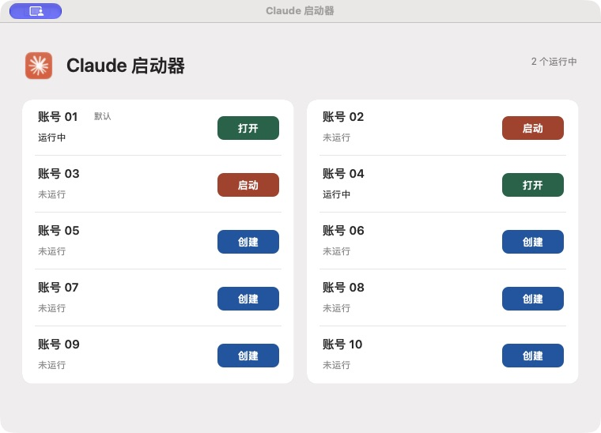

# Claude 启动器

非官方工具，与 Anthropic 无关联。原生 macOS 桌面账号启动器。源码与本机 build/：1.6（build 7，未发布）；历史交付版本为 1.5（build 6）。Objective-C / AppKit。

2026-10-28：在 `feature/isolation-hardening` 加固 macOS 账号隔离，基于 `origin/dev` 的 `ad91581`。本轮不修改 Windows 或构建脚本，版本号仍为 1.6 / build 7；功能差异与验证结果以 [当前状态](docs/STATUS.md) 的最新记录为准。

管理本机的 Claude 桌面账号（最多 10 个，只显示已有的）。水墨风界面：左侧导航（实例管理、账号管理、日志记录、系统设置），右侧账号卡片；运行中显示棕色“打开”，已有目录未运行显示“启动”，无目录显示“创建”，“+ 新建实例”创建第一个未使用的编号。使用同一份官方 Claude.app，通过不同数据目录启动，不复制、修改或重签官方应用。



## 项目结构

```text
src/main.m                  macOS 应用实现与内置自检
windows/                    Windows 版（规划中，未实现）
docs/SPEC.md                跨平台行为规格
scripts/build.sh            构建、签名和自检
scripts/package.sh          打包已构建的应用（ZIP）
scripts/dmg.sh              生成拖拽安装的 DMG
resources/ui/               界面插画（侧栏与卡片）
build/                      开发构建输出（Git 忽略）
releases/1.5/               当前已交付应用副本（Git 忽略）
docs/使用说明.txt            日常使用说明
docs/DEVELOPMENT.md          开发和验证流程
docs/STATUS.md              当前状态、已知问题和待办
docs/history/               历史实测证据，按原版本解读
docs/assets/                界面截图
AGENTS.md                   后续开发约束
```

## 运行与构建

日常使用 `/Applications/Claude 启动器.app`（从 DMG 安装，固定证书签名），不需要安装 Python 或 Node.js。旧版 1.5 副本已于 2026-10-28 按用户要求移到废纸篓。

开发需要 macOS、Xcode Command Line Tools 和 `/Applications/Claude.app` 或 `~/Applications/Claude.app`。在项目根目录执行：

```sh
SIGN_IDENTITY="ClaudeLauncher Local Signing" /bin/zsh scripts/build.sh
/bin/zsh scripts/package.sh
```

设置 `SIGN_IDENTITY` 可用固定证书签名，重建后辅助功能授权不失效，步骤见 [开发流程](docs/DEVELOPMENT.md#打包与签名)。开发应用位于 `build/Claude 启动器.app`，发布 ZIP 位于 `build/Claude启动器.zip`。构建不会替换原交付应用。支持 `SDKROOT` 指定 SDK，默认优先本机兼容的 MacOSX15.4.sdk。当前仅在本机 Apple Silicon 验证，未做 Apple 公证。

## 安装与分发

### macOS（DMG）

```sh
SIGN_IDENTITY="ClaudeLauncher Local Signing" /bin/zsh scripts/build.sh
SIGN_IDENTITY="ClaudeLauncher Local Signing" /bin/zsh scripts/dmg.sh
```

生成 `build/ClaudeLauncher-<版本>.dmg`。打开后把「Claude 启动器」拖到「应用程序」即可安装。应用为通用二进制（Apple 芯片 + Intel），要求 macOS 12 及以上，并需要客户本机已安装官方 Claude 桌面版。

发给客户前须知：

- **未经 Apple 公证。** 当前用自签名证书签名，客户首次打开会被系统拦截（“无法验证开发者”）。客户需要在 Finder 中右键应用选「打开」，或到「系统设置 → 隐私与安全性」点「仍要打开」。正式分发应加入 Apple Developer Program，用 Developer ID 证书签名，再经 `notarytool` 公证并 `stapler` 装订，客户即可直接打开。
- **授权在客户机器上重新授予。** 恢复最小化窗口需要客户自己在「隐私与安全性 → 辅助功能」里允许本应用。
- **图标与名称。** 应用图标为用户自有图标（resources/icon/），不再复制官方 Claude 图标；名称仍含“Claude”。对外分发前请自行确认商标与图标的使用许可，必要时换成自有图标和名称。
- 本机安装位置为 `/Applications/Claude 启动器.app`。重新构建不会自动更新已安装版本，需重新生成 DMG 安装（证书不变时辅助功能授权保留）。

### Windows（安装程序，待做）

计划由 Windows 端提供 Setup 安装程序（例如 Inno Setup 或 WiX/MSIX），安装到“程序”目录并创建开始菜单与桌面快捷方式，带卸载入口。详见 [windows/README.md](windows/README.md) 待办。

## 隔离范围

01 使用 Claude 默认目录；02 使用 Claude-Second；03～10 使用 Claude-Profile-03 至 Claude-Profile-10，均位于用户 Library/Application Support 下。已有目录直接复用。

1.6 起，02～10 新启动时设置 `CLAUDE_CONFIG_DIR=<账号目录>/ClaudeCodeConfig`，请求 Code 使用独立的用户配置、记录和插件目录。01 保持默认 `~/.claude`，与普通终端 CLI 共用默认用户配置。旧实例不自动重启，旧记录不迁移、不删除；Code 实际写入位置仍需真实实例验证。

卡片显示“Code 待启动”“Code 未确认”或“Code 已指定”。“已指定”仅表示本次启动器向核实的新进程指定了独立配置，不代表实际存储已验证。重开启动器后，对已有进程保守显示“未确认”；不读取进程环境变量来恢复状态。

从账号“···”菜单进入“登录 / 重新登录保护…”。新建账号时弹出提醒，可选“直接创建”（其他 Claude 保持运行）或“进入登录保护”。进入保护需要其他 Claude 已正常退出且没有其他账号正在检查或启动。保护保存在启动器偏好中，用户核对身份后确认结束；不会自动退出、登出任何账号，也不能拦截外部启动或系统回调。

存储元数据检查在后台执行，各账号独立等待。检查完成后重新核对进程和路径；原实例在检查期间退出时不会被自动重启。删除仍仅经菜单确认后移到废纸篓，01、运行中、启动中、检查中和受登录保护的账号不可删。

独立目录不是安全沙箱。系统权限、应用身份和加密设施、浏览器登录回调、日志目录（~/Library/Logs/Claude）、网络与本地服务仍可能共享。不同账号共同操作同一项目时，项目文件、规则和工具配置也会互相影响，建议使用各自项目副本和端口。两个真实账号登录、重登录及相互登出的影响尚未验证。

签名身份已稳定；新版 GUI 操作和真实账号隔离的验收结果分别记录，详见 [项目状态](docs/STATUS.md)。
