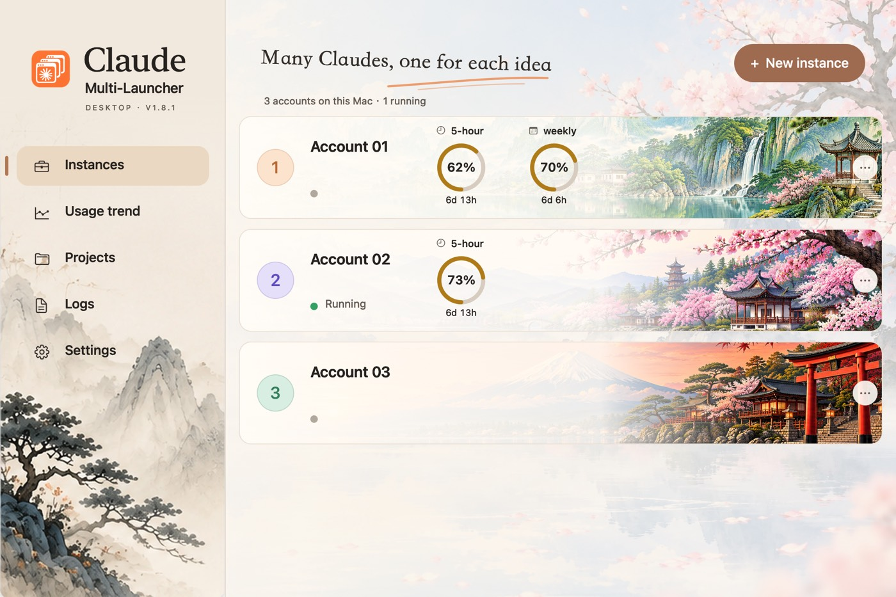
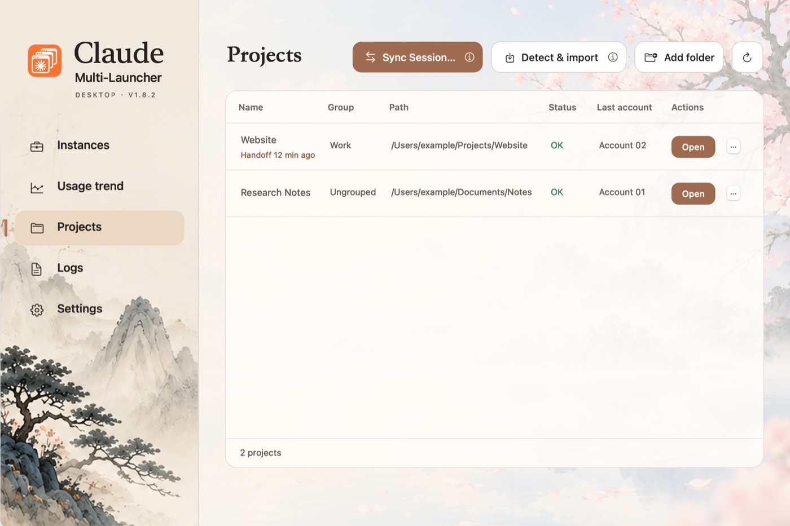
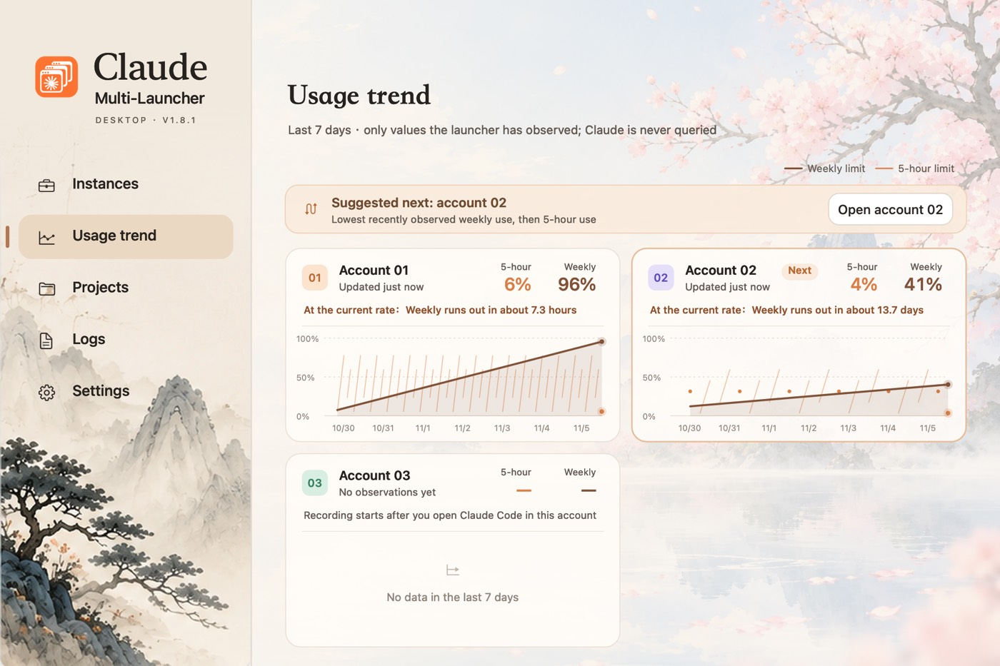

# Claude Launcher Guide

The launcher manages several Claude accounts on one Mac. This guide covers the four core things. Everything stays on your Mac, and nothing is sent to Claude.

## Accounts: start, switch, create

- **Start**: when an account isn't running, click anywhere on its card. The launcher checks your local network setup first and opens Claude after you confirm.
- **Switch**: when an account is running, clicking its card takes you to that account's window. ⌘1–⌘0 open accounts too.
- **Close and delete**: the ··· menu on the card launches or opens, closes (like pressing ⌘Q in Claude) or deletes the account.
- **Usage**: the two rings show the observed 5-hour and weekly usage, with the time until reset below; a quota not seen yet is left out.
- **Create**: click + New instance at the top right. The launcher creates the next free account, up to 10. Then sign in yourself in the Claude window that opens.

Each account keeps its own sign-in and sessions. Quitting the launcher doesn't quit Claude.

## Projects: one list for all accounts

- **Add folder**: put the project folders you use into the list.
- **Detect & import**: find folders from each account's local records. It doesn't read conversations or change account data.
- **Open a project**: choose an account on the project's row. The launcher opens it and copies the path, then select that folder in Claude.

Take turns on a shared project, because the launcher can't detect simultaneous edits. Removing a project from the list doesn't delete files.

## Sync sessions: continue on another account

When an account is running out of quota, you can take a session to another account.

- On the Projects page, click Sync Session…, tick the sessions and pick a target account. Quit the target account normally first.
- The launcher writes a cleaned copy with no account details, and the two never merge. For a session synced before, the newest version wins: when it changed, it replaces the old version on the other side, and the old version goes to the Trash. That side then holds cleaned content only.
- Open the target account. The session appears in the sidebar, with "Synced" and the time after its title. You send the first message yourself.

## Usage trend: which account next

- The Usage trends page in the sidebar shows each account's 5-hour and weekly usage for the last 7 days.
- The banner at the top suggests which account to use next, and can start or switch to it.
- The numbers only come from what the launcher has seen on screen. It never queries Claude. Recording starts once you open that account's Claude Code.

## See it again

In Settings → About → Tutorial, click Tutorial to replay the tour or come back to this guide.
