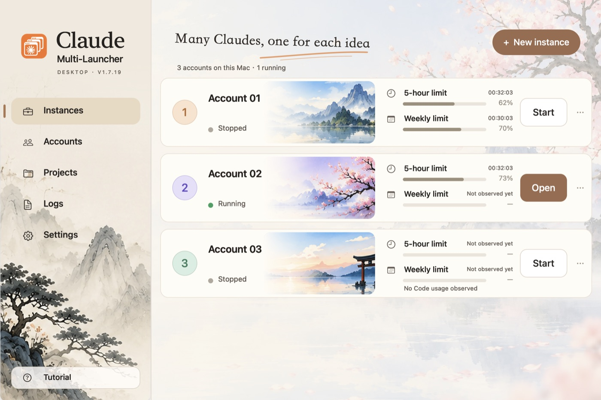
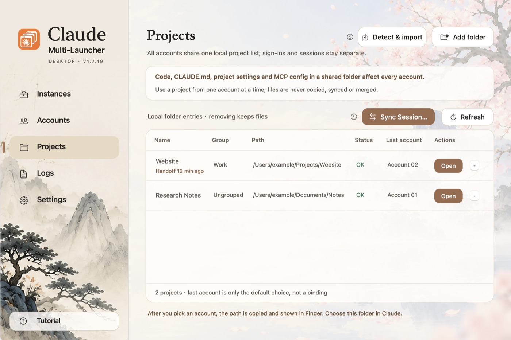
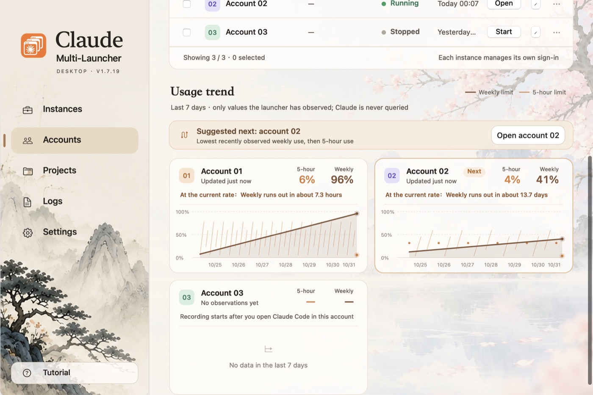

# Claude Launcher Guide

The launcher manages several Claude accounts on one Mac. This guide covers the four core things. Everything stays on your Mac, and nothing is sent to Claude.

## Accounts: start, switch, create

- **Start**: when an account isn't running, click Start on its card. The launcher checks your local network setup first and opens Claude after you confirm.
- **Switch**: when an account is running, the button becomes Open and takes you to that account's window. ⌘1–⌘0 open accounts too.
- **Create**: click + New instance at the top right. The launcher creates the next free account, up to 10. Then sign in yourself in the Claude window that opens.
- **Manage**: Accounts in the sidebar lists every account in a table you can search, filter and sort. You can also give accounts local aliases.

Each account keeps its own sign-in and sessions. Quitting the launcher doesn't quit Claude.

## Projects: one list for all accounts

- **Add folder**: put the project folders you use into the list.
- **Detect & import**: find folders from each account's local records. It doesn't read conversations or change account data.
- **Open a project**: choose an account on the project's row. The launcher opens it and copies the path, then select that folder in Claude.

Take turns on a shared project, because the launcher can't detect simultaneous edits. Removing a project from the list doesn't delete files.

## Sync sessions: continue on another account

When an account is running out of quota, you can take a session to another account.

- On the Projects page, click Sync Session…, tick the sessions and pick a target account. Quit the target account normally first.
- The launcher only adds a cleaned copy with no account details. The original session stays as it is, and the two never merge.
- Open the target account. The session appears in the sidebar, with "Synced" and the time after its title. You send the first message yourself.

## Usage trend: which account next

- Scroll down on the Accounts page to see each account's 5-hour and weekly usage for the last 7 days.
- The banner at the top suggests which account to use next, and can start or switch to it.
- The numbers only come from what the launcher has seen on screen. It never queries Claude. Recording starts once you open that account's Claude Code.

## See it again

Click Tutorial at the bottom of the sidebar to replay the tour or come back to this guide.
