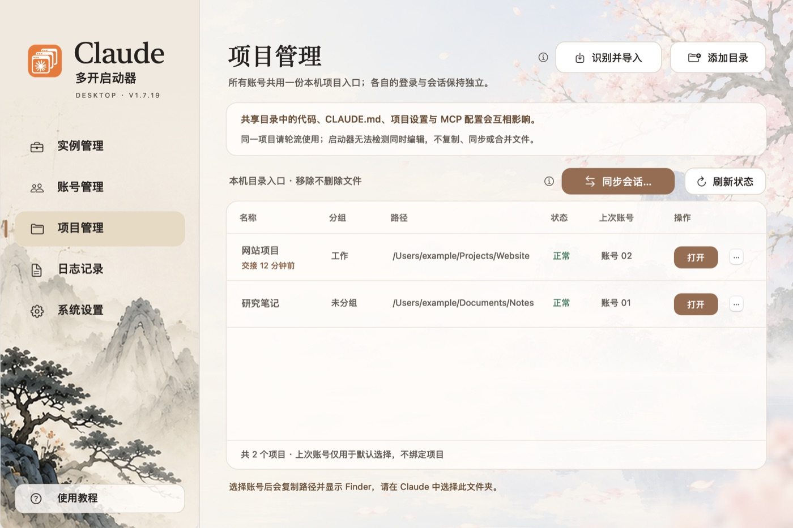

# Claude 启动器使用教程

启动器在一台 Mac 上管理多个 Claude 账号。这里只讲四件核心的事，全程本机操作，不向 Claude 发送任何请求。

## 账号：启动、切换、新建

- **启动**：账号没运行时，点卡片右侧的“启动”。启动前会检查本机网络环境，确认后才打开 Claude。
- **切换**：账号已运行时，按钮变成“打开”，点它会切到这个账号的窗口。⌘1～⌘0 也能打开对应账号。
- **新建**：点右上角“+ 新建实例”，启动器会创建下一个空闲账号，最多 10 个。然后在打开的 Claude 里自己登录。
- **管理**：侧栏“账号管理”把所有账号列成表，可以搜索、筛选、排序，给账号起本地别名。

账号的登录和会话相互独立。退出启动器不会退出 Claude。

## 项目：一份清单，所有账号共用

- **添加目录**：把常用的项目文件夹加进清单。
- **识别并导入**：从各账号的本机记录里找出用过的目录。不读对话内容，不改账号数据。
- **打开项目**：在项目行选一个账号，启动器会打开它并复制路径，在 Claude 中选择这个文件夹即可。

同一个项目请轮流使用，启动器无法检测同时编辑。从清单移除项目不会删除文件。

## 同步会话：换个账号接着聊

额度快用完时，可以把会话带到另一个账号。

- 在项目管理页点“同步会话…”，勾选会话，选目标账号。目标账号要先正常退出。
- 启动器只新增一份清理过的副本，不带账号信息。原会话不变，两边不会合并。
- 打开目标账号，侧栏会出现这些会话，标题后带“同步”和时间。第一条消息由你手动发送。

## 用量趋势：下一个用哪个账号

- 账号管理页往下滚动，能看到每个账号近 7 天的 5 小时和周用量曲线。
- 顶部建议条会提示下一个适合使用的账号，也可以直接启动或切换。
- 数值只来自启动器已经观察到的界面显示，启动器不查询 Claude。打开账号的 Claude Code 后才开始记录。

## 再看一遍

点侧栏底部的“使用教程”，可以重新播放引导，或回到这份文档。
