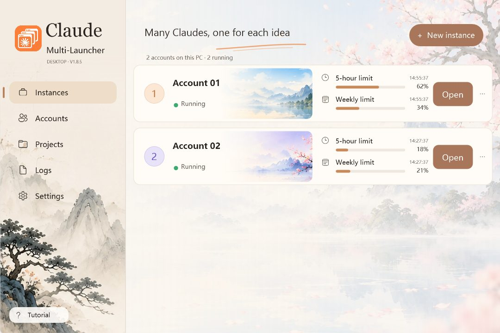
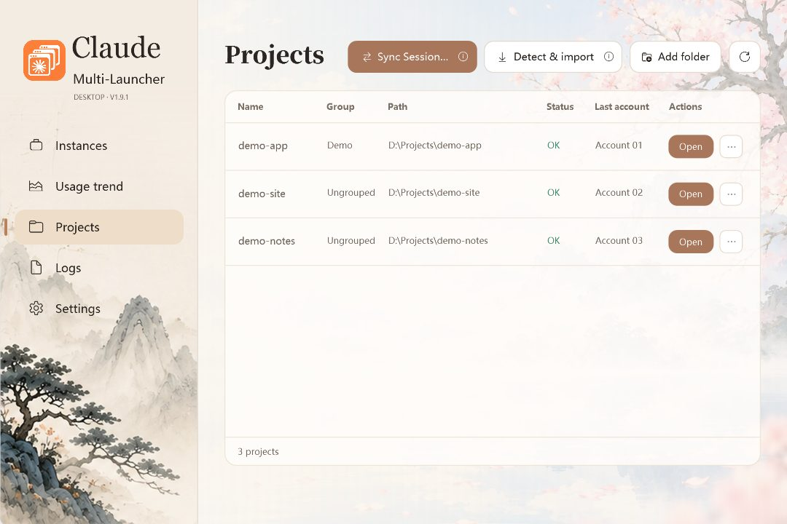
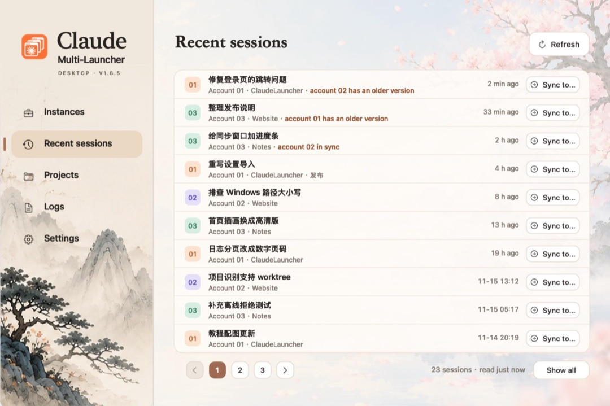

# Claude Launcher Guide

The launcher manages several Claude accounts on one Windows PC. This guide covers the four core things. Everything stays on your PC, and nothing is sent to Claude.

## Accounts: start, switch, create

- **Start**: when an account isn't running, click anywhere on its card. The launcher checks your local network setup first and opens Claude after you confirm.
- **Switch**: when an account is running, click anywhere on its card to open its window. Ctrl+1–Ctrl+0 open accounts too.
- **Create**: click + New instance at the top right. The launcher creates the next free account, up to 10. Then sign in yourself in the Claude window that opens.
- **Recent**: Recent sessions in the sidebar lists recently changed sessions from every account, and each row can sync to another account.

Each account keeps its own sign-in and sessions. Quitting the launcher doesn't quit Claude.

## Projects: one list for all accounts

- **Add folder**: put the project folders you use into the list.
- **Detect & import**: find folders from each account's local records. It doesn't read conversations or change account data.
- **Open a project**: choose an account on the project's row. The launcher opens it and copies the path, then select that folder in Claude.

Take turns on a shared project, because the launcher can't detect simultaneous edits. Removing a project from the list doesn't delete files.

## Sync sessions: continue on another account

When an account is running out of quota, you can take a session to another account.

- On the Projects page, click Sync Session…, tick the sessions and pick a target account. Quit the target account normally first.
- What gets written is a cleaned copy with no account details, and the two never merge. A session synced before follows its newest version: syncing again replaces the old version on the other side, and the old version goes to the Recycle Bin.
- The target account must have been opened from the launcher and have created a local session once. For an account the launcher created, once it gets that far and quits, the launcher asks once whether to sync sessions from your other accounts.
- If the target account has signed in to several accounts or organizations, the launcher reads its current organization once after you click sync and writes only into that folder. If it cannot read it, nothing is written.
- Open the target account from the launcher. The session appears in the sidebar, with "Synced" and the time after its title. You send the first message yourself.

Any Claude version works. If the target account's session records change format, the launcher refuses to write and tells you.

## Recent sessions: what changed lately, synced in two clicks

- Recent sessions in the sidebar lists the sessions of every account together, by last modified time, newest first. Ten per page, or click Show all.
- Each row shows the title, account, project and time. A synced session is listed once, as its newest copy; the row says which other accounts are synced or hold an older version.
- Click Sync to… on a row and pick a target account to open the same preview as the sync window. Nothing is written until you confirm. The source, accounts already up to date and running accounts can't be picked.
- The page only reads when you open it or click Refresh, reads the same fields as the sync window, and keeps nothing on disk. When the launcher reopens on this page it doesn't read on its own; it shows Load recent sessions.

## See it again

Open Settings, About and click Tutorial to replay the tour or come back to this guide.
